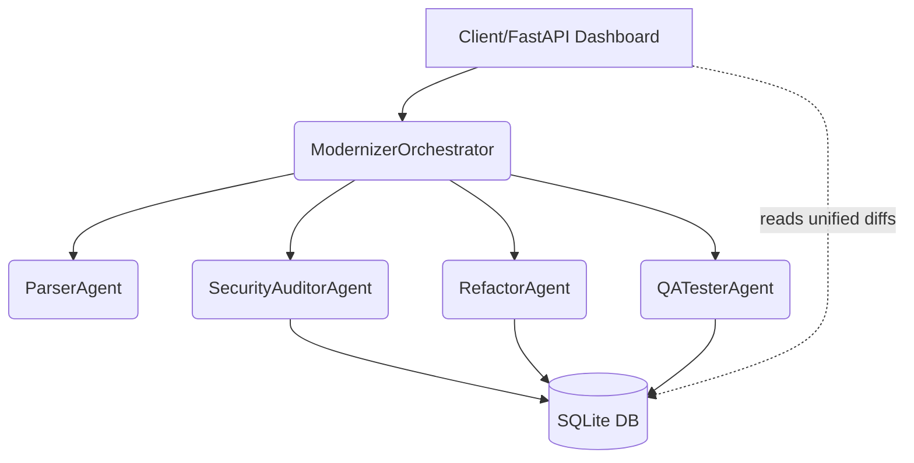

# CodeModernizer-AI

## Mission Statement
CodeModernizer-AI is a production-grade multi-agent enterprise application designed to autonomously analyze, audit for CVE/security vulnerabilities, and modernize legacy software repositories.

## Problem Statement (Enterprise Code Debt & Vulnerabilities)
Large enterprises accrue massive technical debt and security vulnerabilities over time. Manual remediation is costly, slow, and prone to human error. CodeModernizer-AI leverages autonomous AI agents to parse codebase ASTs, detect vulnerabilities (like SQL injection and hardcoded secrets), and apply automated clean-code refactorings with surgical Git diffs.

## Architectural Diagram

## Specialized Agents
- **ModernizerOrchestrator**: Central coordinator orchestrating the multi-agent pipeline.
- **ParserAgent**: Parses repository code trees (AST mapping, import graphs).
- **SecurityAuditorAgent**: Scans for security antipatterns (SQLi, hardcoded secrets) and logs structured findings.
- **RefactorAgent**: Applies automated modernizations (async/await, type hints) and generates diffs.
- **QATesterAgent**: Safely verifies refactored code in an isolated sandbox.

## Database Models
- `RepositoryScan`: Tracks scan status, repo name, and timestamps.
- `VulnerabilityFinding`: Logs security flaws (severity, file path, line number, description).
- `RefactorJob`: Stores proposed Git diffs and QA test pass/fail results.

## Local Setup & Deployment
Please refer to `RUNBOOK.md` for detailed, step-by-step instructions on environment setup, local preview, and cloud deployment.
